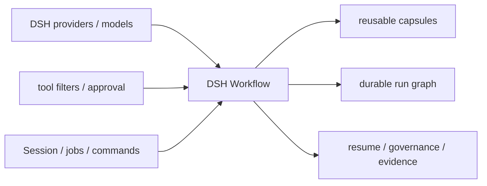

<h1 align="center">DSH Workflow · DSH 0.2.1-rc.3 适配改造版</h1>

<p align="center">
  <strong>把 DeepSeek Harness 的一次性多 Agent 调度，升级为可生成、可保存、可治理、可观察、可恢复的 Workflow 层。</strong>
</p>

<p align="center">
  <a href="LICENSE"></a>
  
  
  
</p>

<p align="center">
  中文 · <a href="README.en.md">English</a> ·
  <a href="#这是什么">这是什么</a> ·
  <a href="#安装">安装</a> ·
  <a href="#现在怎么用">现在怎么用</a> ·
  <a href="#相对上游改了什么">改动清单</a> ·
  <a href="docs/KODAX_PARITY.md">对标矩阵</a>
</p>

> **本仓库不是上游官方仓库，而是上游的「需求化改造版」。**
> 代码基线上游是 [omdsh-dev/dsh_workflow](https://github.com/omdsh-dev/dsh_workflow) `v0.1.2`（MIT，面向 DSH `0.0.1-rc.2`）。本仓库把它改造成能在**当前这台机器实际的 DSH `0.2.1-rc.3`** 上直接安装、直接运行的版本：**不删功能、不改交互、不放宽安全边界**，只重写宿主接缝，并把"必须旁挂私有 DSH 源码 checkout 才能构建"改成"直接编译 npm 上发布的 `@deepseek-ai/*` 能力包"。

## 这是什么

| 项目 | 内容 |
| --- | --- |
| 上游项目 | [omdsh-dev/dsh_workflow](https://github.com/omdsh-dev/dsh_workflow) `v0.1.2`，MIT，目标宿主 DSH `0.0.1-rc.2` |
| 本仓库 | `PatTianFang/dsh_workflow_fang` `v0.2.0`，MIT，目标宿主 DSH **`0.2.1-rc.3`** |
| 关系 | 上游的**适配改造版（port）**，不是官方发布、不是 DSH 官方插件、不是上游的功能分支 |
| 改造范围 | 只重写宿主接缝 + 工程化（npm 构建、兼容 pin、验证脚本）；**用户可见功能 1:1 保留** |
| 不是改造范围 | 没有新增用户功能，没有删除已有能力，没有修改命令语义、capsule 格式、安全策略 |

改造坚持三条原则：

1. **功能不减**：三工具、`/workflow` 全部子命令、六个 pattern、两个 built-in、胶囊与 run 图、缓存续跑、只读策略、结构化输出修复、后台 job、原生 `tool-workflow/*` 事件全部在位。
2. **行为可验证**：上游 179 个测试全部迁移并全绿（断言数量逐文件对比无删减），且新增"安装后可真实跑通"的端到端验证。
3. **边界不放宽**：QuickJS capability VM、JSON 边界、确定性 guard、只读掩码、审批分级一条没少；宿主不再提供的能力改为 fail loud，而不是静默降级。

## 相对上游改了什么

DSH 从 `0.0.1-rc.2` 到 `0.2.1-rc.3` 换掉了插件赖以工作的多数接缝，所以改造集中在"怎么说"，不在"做什么"：

| 领域 | 上游写法（DSH `0.0.1-rc.2`） | 本仓库写法（DSH `0.2.1-rc.3`） |
| --- | --- | --- |
| 子 Agent 启动 | `ctx.subagents.start(provider, request)` | `startActivation({ provider, label, request, signal, delivery: 'caller' })` |
| 子 Agent 句柄 | `SubagentRun.localAgent` | `parent.ctx.agents.get(childId)` |
| 只读子 Agent | `request.toolFilter`（宿主已删除该字段） | 子 Agent 发布后在其自身 scope 上 `child.ctx.tools.restrict(mask)` |
| 会话历史 | `session.events` | `session.ownEvents()` |
| 工具证据 | `tool/result` 的内容块 | `tool/result` 的 `message.toolCallId` / `message.isError` |
| 插件消息来源 | `{ kind: 'plugin', plugin }`（已废弃） | 自注册 `{ kind: 'dsh-workflow', form }` |
| 后台 job | `owner: Agent`、`done.output` | `owner: agent.session.id`、`done.result` |
| 原生 run-start 事件 | `{ runId, name, turn: null }` | `{ runId, name }` |
| 构建方式 | 旁挂私有 DSH checkout，pnpm `link:` | 直接依赖 npm 发布的 `@deepseek-ai/*`，npm 构建 |
| 兼容校验 | 比对私有 checkout 的 git commit | [`compatibility.json`](compatibility.json) v2 固定各包版本 + 校验原生投影契约 |

两处用户可能感知的边界变化，均为宿主能力变化所致，且都是"更严格"而非"更宽松"：

- **只读**：宿主删除了派发期 `toolFilter`，改为对已发布子 Agent 的 scope 施加同一份 allow-list；provider 不发布本地子 Agent 时直接报错，**不会**退化成无约束运行。
- **结构化修复子 Agent**：过去用 `toolFilter: { allow: [] }`，现在改为 deny 掉全部可见工具，效果相同（只能改写文本，不能调查）。

逐项详细说明见 [v0.2.0 改造说明](docs/features/v0.2.0.md)，版本记录见 [CHANGELOG](CHANGELOG.md)。

## 安装

要求：Node.js `>=22.19`，DSH 包代与 [`compatibility.json`](compatibility.json) 一致（当前 `0.2.1-rc.3`）。

```sh
# 1) 从本仓库安装（产物已随仓库提交，用户侧不需要编译）
dsh plugin --profile desktop add "github:PatTianFang/dsh_workflow_fang#main"

# 2) 或从本地目录安装
dsh plugin --profile desktop add /path/to/dsh_workflow_fang

# 3) 或从已打包 tarball 安装
npm pack
dsh plugin --profile desktop add /path/to/dsh-external-workflow-0.2.0.tgz
```

在 DeepSeek Harness Desktop 里，也可以直接用插件管理器指向本包目录安装。

安装后 profile 合成树中应出现：

```yaml
- id: dsh-external-workflow
  name: '@dsh-external/workflow'
```

**生效验证**（三种任选）：

```sh
dsh --profile desktop --dump-config          # 看到上面两行
```

```text
/workflow list                                # 会话里能列出 built-in / pattern / 项目 / 个人 workflow
```

模型侧出现 `workflow_list`、`run_workflow`、`workflow_manage` 三个工具即表示已挂载。

## 现在怎么用

一句话：**斜杠命令给人用，三个工具给模型用，两者共用同一个引擎、同一份 run 记录、同一套安全策略。**

### 1. 先看有什么

```text
/workflow list
```

会列出：2 个 built-in（`parallel-investigation`、`scoped-review`）、6 个 pattern（`classify-and-act`、`fan-out-and-synthesize`、`adversarial-verification`、`generate-and-filter`、`tournament`、`loop-until-done`）、你的项目级 `.dsh/workflows` 和个人级 `$DSH_HOME/workflows`。

### 2. 跑一个现成的

```text
# 参数化并行调查：按 rubric 拆多个视角，最后合成
/workflow parallel-investigation {"question":"为什么这个测试会间歇失败？"}
```

### 3. 让它为你的任务生成一个

```text
/workflow create 为这个仓库设计一个并行安全评审流程，重点看权限与路径处理
```

这不是"再问模型一次"：命令立即结束，把原始 query 作为**真正的 user message** 交给当前主 Agent（所以会话标题、左侧工作区都能识别），主 Agent 先用自身工具调查真实仓库，再用 `source + manifest` 调用 `run_workflow` 生成并启动流程；生成脚本在 QuickJS 沙箱里执行，启动前做冒烟校验与一次性授权。

### 4. 代码评审开箱即用

```text
# 评审当前未提交改动（默认）
/workflow review

# 评审与 main 的差异，带约束与测试证据，同步等结果
/workflow review base --risk high \
  --requirement "不得破坏公开 API" \
  --test-evidence "npm test 通过" \
  --wait -- 重点看错误处理
```

它会捕获 Git diff、生成 content-addressed 评审包（packet + 约束 + 证据），再跑 `scoped-review`：双 primary + 逐 finding verifier + audit artifact。

### 5. 看运行、控运行、复用运行

```text
/workflow runs                     # 最近 20 个 run
/workflow show                     # 最新 run 详情（--full 含完整事件）
/workflow stop                     # 停当前活动 run
/workflow save <runId> my-flow     # 把这次生成流程存成可复用 workflow
/workflow my-flow {"k":"v"}        # 按名字再跑一次
/workflow rerun <runId|名字>       # 按快照/当前版本重跑
/workflow resume-run <runId>       # 命中缓存续跑剩余任务
```

运行产物默认落在**当前项目**的 `.dsh/workflow-runs/<run-id>/`（`run.json`、`events.jsonl`、不可变 snapshot、`results/` 缓存、`artifacts/`），同时写入原生 `tool-workflow/*` Session 事件，所以 DSH Web 里能直接看到流程进度。

### 6. 常用命令速查

```text
/workflow help
/workflow list
/workflow create <request>
/workflow review [base | sha <hash>] [--lean] [--risk low|medium|high] [--requirement "..."] [--test-evidence "..."] [--wait] [-- <focus>]
/workflow <name> [JSON args]
/workflow runs [--all|--limit N]
/workflow show [--full] [runId]
/workflow pause|resume|stop [runId]
/workflow rerun|resume-run <runId|savedName> [JSON args] [--wait]
/workflow save <runId> <name> [project|personal]
/workflow rename-run <runId> <display name>
/workflow rename-saved <from> <to> [project|personal]
/workflow revise <savedName> <change>
/workflow delete-run <runId> [--force]
/workflow delete-saved <name> [project|personal]
/workflow prune [--dry-run] [--keep N] [--older-than 7d|24h]
```

`/workflow create` 与"未知名称 + 自然语言"形式**不接受** `--wait`（生成由当前 Agent turn 接管）；命名 workflow、`rerun`、`resume-run`、`review` 支持 `--wait`。模型工具对应参数是 `wait: true`。

workflow 启动和 `run_workflow` 默认立即返回 `{ runId, status, jobId? }`，不占用当前 turn；`/workflow show` 默认显示最新 run，`/workflow stop` 默认停当前活动 run。

### 7. 让模型直接用工具

| 工具 | 用途 | 典型调用 |
| --- | --- | --- |
| `workflow_list` | 发现 built-in / pattern / 项目 / 个人 workflow；无效条目只报告不执行 | 直接调用 |
| `run_workflow` | 运行命名 workflow、自然语言生成新流程、或执行受限 inline workflow | `{ name }` / `{ request }` / `{ source, manifest, args, wait }` |
| `workflow_manage` | 查看、暂停、恢复、停止、重跑、续跑、保存、改名、修订、删除、清理 | `{ action, target, ... }` |

内联工作流的最小形态（也是 `/workflow create` 交给主 Agent 的契约）：

```js
async function run(wf, args) {
  return await wf.phase('analyze', async () => {
    const r = await wf.runAgent({ name: 'analyst', prompt: String(args?.q ?? 'analyze'), readOnly: true, modelHint: 'balanced' })
    return r?.finalText ?? 'no result'
  })
}
```

```json
{"name":"focused-analysis","description":"Analyze with one specialist.","phases":["analyze"],"readOnly":true,"maxAgents":1,"maxConcurrency":1,"patterns":["classify-and-act"]}
```

`modelHint` 只能是 `fast | balanced | deep`；`readOnly: true` 时子 Agent 只能看到只读 allow-list 内的工具。

### 8. 配置

默认值即可用；需要调优时在 profile 的 `cordis.patch.yml` 覆写（完整字段见 [配置参考](docs/CONFIGURATION.md)）：

```yaml
- id: dsh-external-workflow
  name: '@dsh-external/workflow'
  config:
    approvalMode: generated-and-local  # never | generated-and-local | always
    maxAgents: 64
    maxConcurrency: 8
    maxRetainedRuns: 500
    fastProvider: spawn                # ctx.subagents transport
    fastModelProvider: deepseek-official
    fastMaxTokens: 4096
    balancedProvider: spawn
    balancedModelProvider: deepseek-official
    balancedMaxTokens: 8192
    deepProvider: spawn
    deepModelProvider: deepseek-official
    deepMaxTokens: 16384
    readOnlyAllowedTools:              # 与当前父 Agent 可见工具动态求交集
      - read
      - read_image
      - glob
      - grep
      - lsp
      - skill
      - web_search
```

`availableTools`、`availableMcp`、`availableSkills` 是部署能力清单，供 capsule preflight 使用；workflow 声明的 requirement 不在清单中会失败，不会偷偷降级。

## 它为 DSH 带来什么

DSH 已经有很强的 Harness 基础设施：模型路由、子 Agent provider、工具权限、审批、Session 日志、后台 jobs 与 UI 事件。但仅有这些"执行原语"，团队仍需在每次会话里重新描述如何拆解、并发、验证和汇总。

| 只有一次性调度时 | 安装 DSH Workflow 后 |
| --- | --- |
| 每轮重新提示如何拆任务，策略难复用 | 保存为项目或个人 workflow，按名字运行 |
| 并行结果散落在会话里 | run graph、事件、artifact、结果摘要和成本永久落盘 |
| 中断后通常从头重来 | 按 run snapshot 重跑，或用 effect cache 续跑未完成部分 |
| provider/模型/并发/预算靠提示词约束 | manifest + preflight + 运行时硬限制 |
| 生成的脚本容易越权或不可复现 | capability-only VM、JSON 边界、确定性 guard、审批分级 |
| 复杂流程只有作者自己知道怎么用 | capsule 自带 intent、inputs、requirements、provenance |
| 多 Agent 是一次性技巧 | 多 Agent 变成可审计、可分享、可演进的工程资产 |



## 能力

### 与 KodaX workflow 对标的执行模型

- 版本化 `dsh.workflow` v1 capsule：manifest、source、intent、inputs、requires、provenance。
- 统一 `async function run(wf, args)` 模型。
- 完整 WorkflowApi：`phase`、`spawnAgent`、`runAgent`、`wait`、`snapshot/output`、`send/stop`、`parallel`、`pipeline`、`synthesize`、单层嵌套 workflow、artifact、log、budget。
- `runAgent` 对普通子任务失败返回 `null`，让 workflow 能按策略降级；显式 handle 的 `wait` 仍保留完整失败结果。要求 object JSON Schema 的任务在原生 structured capture 缺失时只做一次同路由、无工具修复，仍不合规则明确失败。
- Agent 元数据：phase、scope、constraints、read-only、provider/subagent type、fast/balanced/deep 路由、显式 model、isolation、token、evidence、verification、output schema、terse result。
- 两个 built-in：可按 rubric/agent/concurrency 参数化的 `parallel-investigation`，以及完整 packet/schema/read-contract/双 primary/逐 finding verifier/audit artifact 的 `scoped-review`。公共 `writeReviewPackets()` 从调用方已经捕获的 diff、约束和测试证据生成工作区内 content-addressed、不可覆写的分区文件；`/workflow review` 可直接捕获当前 Git 范围并启动该流程，不依赖 DSH 核心额外提供 `/review` patch。
- 稳定的 ProcessSnapshot、WorkflowOutcome 与 AgentResult 投影：包含 item/count/progress、失败与未验证结果、structured output、验证证据、路由、usage、artifact 和缓存重放来源。
- 六个标准 pattern：classify-and-act、fan-out-and-synthesize、adversarial-verification、generate-and-filter、tournament、loop-until-done。

完整逐项验收见 [KodaX 对标矩阵](docs/KODAX_PARITY.md)。本项目只参考行为与能力，不复制 KodaX 的受限许可源码。

### 发现与复用

搜索顺序是 deterministic 的：

1. 插件内置 workflow 与 pattern（不可被磁盘文件遮蔽）；
2. 项目目录 `.dsh/workflows`；
3. 个人目录 `$DSH_HOME/workflows`。

项目同名条目覆盖个人条目；同一目录中 `.workflow.json` 优先于 `.ts/.mjs/.js`。符号链接、路径逃逸、超大文件、未知 capsule 字段、版本不兼容和 manifest/文件名不一致都会在执行前失败。

受限 capsule 示例见 [examples/review.workflow.json](examples/review.workflow.json)。可信本地模块适用于人工维护的高权限流程，但每次执行都需要显式确认。

### 生命周期、持久化与续跑

每个 run 都有 `running → paused/completed/failed/denied/stopped` 状态和稳定 id。默认在项目中写入：

```text
.dsh/workflow-runs/<run-id>/
├── run.json                    # 状态、结果摘要、成本
├── events.jsonl                # append-only 事件图
├── workflow.workflow.json      # 不可变执行快照（生成型 workflow）
├── results/                    # 只保存已完成且验证通过的确定性 effect cache
└── artifacts/                  # workflow 命名证据
```

- 按 run id 重跑：使用该 run 的不可变 capsule snapshot。
- 按 saved name 重跑：使用当前保存版本。
- `resume-run`：相同调用序号 + 相同 task input 命中缓存，其余任务继续执行。
- 终态 run 自动按 `maxRetainedRuns` 清理；也可 preview/执行 `prune`。
- 同时记录原生 `tool-workflow/*` Session 事件，复用 DSH 已有 UI/可观察性。动态 workflow 的 run-start 使用 Session 生命周期：启动它的 tool step 或 Agent turn 结束时，后台流程仍保持 `running`，直到真实 `run-end` 决定完成、失败或取消，不再被 UI 误标为"已中断"。

斜杠命令通过 `ctx.userQuestions` 做一次性人类确认；模型工具使用 DSH 当前 turn 的 `ctx.approval`。后台运行会尽可能注册到 `ctx.jobs`，并始终保留插件自己的 durable run id。三条路径共享同一个引擎、run store 和安全策略。

## 安全与能力边界

- 生成型脚本只能通过冻结的 WorkflowApi 发起 effect；脚本结果、参数和 RPC 值必须可 JSON 序列化。
- 生成脚本运行在 QuickJS WebAssembly 独立堆中；宿主只暴露 JSON capability RPC。静态 policy 还会拒绝 import/require、process、文件、shell、网络、timer 与非确定性 API。
- 同步执行、总墙钟、WASM 内存与栈都有上限；主函数返回或墙钟超时时会关闭 RPC、abort run，并等待所有已接收的宿主 RPC 与已发布 child 静默退出。可信本地模块仍具有宿主权限。
- `readOnly: true` 使用"当前父 Agent 可见工具 ∩ 可信只读 allow-list"，未来新增写工具默认不可见。DSH 0.2 已取消每次派发的 `toolFilter`，因此该掩码改为在子 Agent 发布后立即施加到它自己的 scope（`child.ctx.tools.restrict`）；provider 未发布本地子 Agent 时直接失败，不会在无约束状态下运行。
- token budget 在子 Agent 发布前预留，本地 Agent 有 usage 时按 Session 实际值核算。
- read-path、成功 mutation tool + Git workspace 指纹变化、每个 required changed path 的前后内容指纹、final-text 与 bounded same-actor repair 已内建；部署可以用带稳定 `cacheIdentity` 的 `registerVerificationAdapter()` 叠加非 Git 或更强的 workspace 证据。worktree 通过 `registerIsolationAdapter()` 接入，未注册时明确失败。
- catalog 保存/替换/改名/删除使用规范化根目录、逐段 junction/symlink 拒绝与原子独占发布；并发同名保存不会互相覆盖。
- DSH 通用 subagent seam 没有原生 existing-agent target / effort 控制；部署可在首次运行前注册 `registerDispatchAdapter()` 完整承接这两个字段，否则 fail loud。

更多细节见 [安全模型](docs/SECURITY.md)和[架构说明](docs/ARCHITECTURE.md)。

## 开发与验证

插件直接编译自 npm 上发布的 DSH 能力包，版本由 [`compatibility.json`](compatibility.json) 固定，**不再需要旁挂 DSH 源码 checkout**。

```sh
npm install
npm run check           # 兼容 pin + 原生投影契约 + 179 tests + typecheck + build
npm run test:coverage   # 需要额外安装可选的 @vitest/coverage-v8
npm pack                # 产出可安装的 tarball
```

改完代码后重新装到 profile：

```sh
npm run build && npm pack
dsh plugin --profile desktop add /absolute/path/to/dsh-external-workflow-0.2.0.tgz
# 或先在插件管理器里移除旧条目，再加一次
```

升级 DSH 后：先更新 `compatibility.json`（包版本与 `hostVersion`）和 `src/index.ts` 里的 `dshVersion`，再跑 `npm run check`。

## 已知限制

- trusted-local `.ts` 使用 Node 22 原生 erasable-syntax TypeScript，并遵循 Node module cache（修改后重启 DSH）；需要 enum 等 transform-only 语法或热重载时请发布为 `.mjs/.js`。
- DSH `0.2.1-rc.3` 已取消每次派发的 tool filter 与 existing-agent target：只读掩码改为作用于已发布子 Agent 的 scope，target/effort 与 worktree 仍需部署注册 dispatch/isolation adapter，未注册时 fail loud。
- 内建 verification 能证明实际 read/mutation tool evidence、Git workspace 变化、每个 required path 的任务前后指纹与文本后置条件；非 Git 工作区或需要外部权威证据的策略由 verification adapter 补充。
- 仅生成型 capsule run 能保存不可变 script snapshot；纯函数 trusted-package/local run 不能从 run id 再保存。
- capsule v1 与 KodaX capsule 不做 wire compatibility；外部 capsule 不会被误执行。
- capability-generated 源码与宿主对象隔离；但 trusted-local workflow 会以 Node 宿主权限执行，不要把不可信第三方源码标为 trusted-local。
- 本仓库只针对 `0.2.1-rc.3` 验证；宿主升级需按上面的流程重新跑兼容校验。

## 致谢

- [omdsh-dev/dsh_workflow](https://github.com/omdsh-dev/dsh_workflow)：本仓库的上游项目，提供了完整的 workflow 设计、实现与测试基线（MIT）。
- [DeepSeek Harness](https://www.npmjs.com/org/deepseek-ai) 提供 Harness、插件和子 Agent 能力面（`@deepseek-ai/dsh-*`）。
- [KodaX](https://github.com/icetomoyo/KodaX) 提供 workflow 产品设计的行为参考；上游插件为独立实现，本仓库沿用其行为契约。
- `dsh-external` 社区插件为 bundle 安装、验证、安全边界和文档结构提供了实践参考。

## License

MIT，见 [LICENSE](LICENSE)。上游版权归其作者所有；本仓库的改造部分同样以 MIT 发布。
